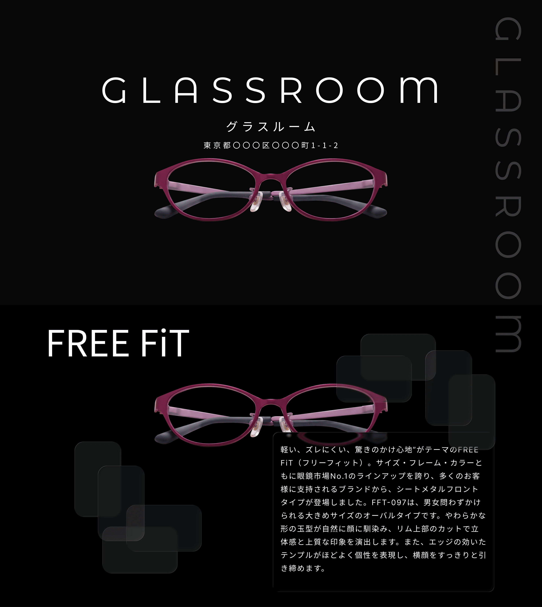
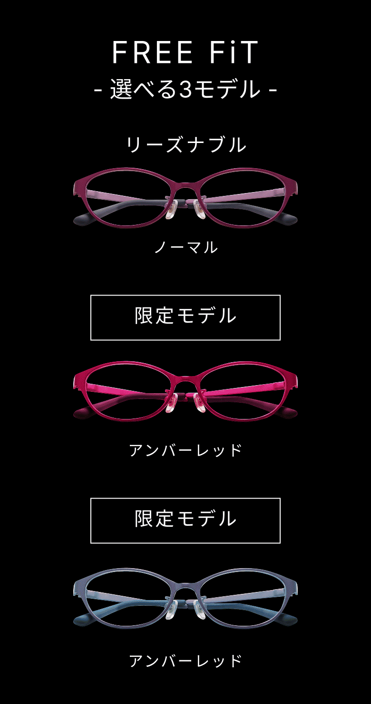

# GLASSROOM

【デモ】
- Site：https://glassroom.see-u-soon.design/
- デスクトップ / モバイル

<table>
  <tr>
    <td width="70%" valign="top">
      
    </td>
    <td width="30%" valign="top">
      
    </td>
  </tr>
</table>

架空の眼鏡ブランドの製品紹介ランディングページです。

## プロジェクトの概要

【製品を分かりやすく伝える】
- 来訪者に、FREE FiT の形と機能を一つのページで見せる。

【スクロールで見せる】
- GSAP 3.15 の視差で動的なアニメーションを実装。

## セクションと主な機能

【HEROセクション】
- ファーストインプレッションでブランド名＋店舗概要＋製品イメージを簡単に伝える。

【FREE FiTセクション】
- 製品の簡単な説明。

【Titanセクション】
- テキスト＋動画で製品イメージを高める。

【4つの特徴セクション】
- それぞれのカードで特徴だけを伝える。

【期間限定モデル】
- アンバーレッドとグレイブルーのフレームを紹介する。

【製品詳細と累計】
- FREE FiT の仕様と、累計カウントを表示する。
- お問い合わせの送信機能は置かない。ダミーのみ。

## 技術スタック

【デザイン】
- Figma Pro（Full Seat）

【コーディング エージェント】
- Cursor Pro

【フレームワーク】
- Next.js 16.3（App Router）。

【言語】
- TypeScript 5。
  ※コンポーネントの props を型で揃えるため。

【UI】
- React 19.2 / Tailwind CSS 4。
  ※Figma の間隔と書体をユーティリティで置くため。

【アニメーション】
- GSAP 3.15 / `@gsap/react` 2.1。
  ※視差、入場、ScrollSmoother を一つの登録口で扱うため。

## 設計上の工夫

【情報の選別と整理】
- なるべく情報が多くならないように、必要な情報だけに絞ってお問い合わせに誘導させる。
- セクションごとに情報を整理してスッキリさせる。

【デザイン】
- 黒色単色の重厚な感じをベースに、デザインを構築。他のカラーは製品カラーのみとし、落ち着いた雰囲気にする。

【アニメーション】
- GSAPを利用することで、一元的にスクロールアニメーションを管理する。

## 品質確認

【品質管理】
- `npm run lint` のエラー：0件
- `npm run typecheck` のエラー：0件
- Viewtest：完了
- Playwright：完了
- local 上での目視・動作確認：完了
- Deploy 後の目視・動作確認：完了
- Lighthouse Desktop Performance：98
- Lighthouse Mobile Performance：93
- Accessibility：95
- Best Practices：100
- SEO：対象外

【Microsoft Edge (Latest)】
- デスクトップ：1440 × 800：完了
- タブレット：768 × 1024：完了

【Google Chrome (Latest)】
- デスクトップ：1440 × 800：完了
- タブレット：768 × 1024：完了

【Safari（iOS・Latest）】
- モバイル：390 × 844：完了

## 作者

【名前】
- Takashi Ogawa

【開発期間】
- 実働 約 2 週間

【その他】
- ポートフォリオ: https://portfolio.see-u-soon.design
- GitHub: https://github.com/onion4989
- GRASS ROOM：https://glassroom.see-u-soon.design/
